<p align="center">
  
</p>
<h1 align="center">Tuck</h1>
<p align="center">Keep your Mac menu bar tidy.</p>
<p align="center">
  
  
  
</p>

Tuck keeps menu icons in **Pocket**, a compact bar beneath the macOS menu bar. Keep the icons you need in view and save the rest in your layout. It shares a monochrome style with [Snap](https://github.com/Upsidedly/snap).

## Arrange your icons

Right-click Tuck’s caret and open **Settings…**. Allow Accessibility, then drag icons between three rows:

| Row | Main menu bar | Pocket |
| --- | --- | --- |
| Always Show | Visible | — |
| Show in Bar | Hidden | Available |
| Never Show | Hidden | Hidden |

Your layout saves automatically. You can also right-click an icon or use its selection control to change its row. Press **⌘Z** to undo the last move.

Supported movable system icons have separate rules. Clock and Control Center stay available. Third-party apps with several menu items share one rule.

## Open Pocket

Click Tuck’s caret or press **⌃⌥B** to open or close Pocket. The caret points left when closed and down when open. Select a Pocket icon to open its real menu. Press **Esc** or click outside Pocket to close it.

## Settings

Right-click the caret for Settings and Quit. Settings opens in a standard Mac window. Choose **Black** or **Liquid Glass** for Pocket. The close timer and **Open at login** start off. Quitting restores your native icons and keeps the saved layout.

Screen Recording is optional. Allow it to show actual menu-bar images in Pocket and Settings. Without it, Tuck uses app artwork. Images are saved snapshots; use **Refresh** when an indicator changes. Capture can briefly reveal a Show-in-Bar item. Never-Show items stay hidden.

## Install from source

Use macOS 27 or later with Swift 6 and a compatible macOS SDK.

```sh
git clone https://github.com/Upsidedly/tuck.git
cd tuck
./scripts/install.sh
open /Applications/Tuck.app
```

Allow Accessibility in **System Settings → Privacy & Security**. Screen Recording is needed only for menu-bar images.

The script builds and signs the app locally and backs up an earlier installation. Quit Tuck before updating it. There is no notarized download yet. After a rebuild, macOS may require you to remove and add Tuck’s permission entries again.

## Compatibility and privacy

Tuck uses a private macOS 27 menu bar API. A future macOS update can change or remove it.

Accessibility lets Tuck read and open menu items. With Screen Recording, it captures the menu-bar strip and saves only cropped icons locally. It reads window geometry to detect when a menu closes. Tuck does not use the network, record audio or upload images. It needs no account.

## Development

Build with `./scripts/build.sh`. Run the core checks with `./scripts/check.sh`. Set `TUCK_SDK` to use another macOS SDK without changing your global Xcode settings.

